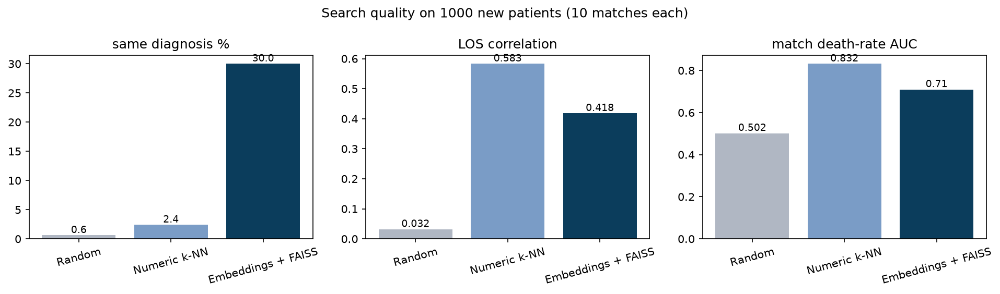

# ICU Patient Similarity Search and RAG with Llama 3.1

Finding similar past ICU patients in MIMIC-III with sentence embeddings and FAISS, then using Llama 3.1 to summarise the matched cases and checking every answer for hallucinations.


---

## Key Results

| Metric | Result |
|---|---|
| Matches with the exact same diagnosis | **30.0%** with embeddings, vs 2.4% numeric k-NN and 0.6% random |
| Match death-rate AUC | 0.71 embeddings, **0.83** numeric k-NN, 0.50 random |
| Search speed | 1,000 searches against 4,000 patients in about 0.2 seconds |
| LLM answers in valid JSON | 10 / 10 |
| Death counts correct / average stay correct | 10 / 10 and 6 / 10 |
| Explanations with an unsupported claim (manual review) | 10 / 10 |

## The Question

My [ICU mortality prediction project](https://github.com/KrishnaKJoshi1/icu-mortality-risk-prediction) answers *"how likely is this patient to die?"*. Clinicians also ask a different question: **"which past patients looked like this one, and what happened to them?"**

This project builds that similar-patient search on the same MIMIC-III data and tests honestly how well it works. It is a retrospective analysis of completed admissions, not a real-time decision-support tool.

## How It Works

```
mimic3c.csv ─► adult cohort (50,740) ─► 5,000 sampled
                       │
                       ▼
     library (4,000 past patients) + new patients (1,000)
                       │
                       ▼
     each row ─► short text summary (no outcome, no length of stay)
                       │
                       ▼
     all-MiniLM-L6-v2 ─► 384-number vector per patient
                       │
                       ▼
     FAISS (exact cosine search) ─► 10 most similar past patients
                       │
         ┌─────────────┴─────────────┐
         ▼                           ▼
  Retrieval evaluation        Llama 3.1 8B (Ollama)
  vs random and numeric k-NN  writes a comparison (JSON)
                                     │
                                     ▼
                          Hallucination check in Python
                          + manual review
```

**Example summary**

```
71-year-old female. Emergency admission from the emergency room. Admitting diagnosis: pneumonia.
First recorded procedure: none recorded. Daily care activity: medium lab tests, medium medications,
medium microbiology tests, low procedures, low charted observations.
```

Its five closest matches all had pneumonia, were aged 69–82 and survived (similarity about 0.98).

## Approach

- **Cohort:** adults with a recorded diagnosis (58,976 → 50,740 admissions, 11.4% in-hospital mortality).
- **Summaries:** each row becomes a short sentence. Daily activity counts become *low / medium / high*, with cut-offs from the library only. Outcome, length of stay, insurance, religion, ethnicity and marital status are left out.
- **Embeddings and search:** `all-MiniLM-L6-v2` (Sentence Transformers) creates the vectors; FAISS `IndexFlatIP` finds the nearest ones.
- **Evaluation:** with no answer key for "similar", matches are judged on diagnosis, age, length of stay and outcome, and compared with random matches and a numeric k-NN baseline on scaled structured features.
- **Generation (RAG):** for 10 new patients, the 5 closest past patients are passed to Llama 3.1 8B, which returns JSON: deaths, average length of stay, most common diagnosis and a short explanation.
- **Hallucination check:** Python verifies each fact against the records; the explanations are also read by hand.
- **Data handling:** the embedding model and Llama 3.1 run on the laptop, so no patient record is sent to an online service.

## Retrieval Results

| Method | Same diagnosis | Age gap | LOS correlation | Match death-rate AUC |
|---|---|---|---|---|
| Random | 0.6% | 18.3 yrs | 0.03 | 0.50 |
| Numeric k-NN | 2.4% | **6.3 yrs** | **0.58** | **0.83** |
| Embeddings + FAISS | **30.0%** | 15.8 yrs | 0.42 | 0.71 |



Embeddings bring the free-text diagnosis into the search, which the numeric method cannot use. Numeric k-NN does better on age, length of stay and outcome, because it uses exact values that the text summary reduces to words and low / medium / high. The two approaches capture different patient details and work best together.

**Where it falls short:** 19 of the 114 patients who died had 10 matches who all survived. Similar-patient search shows what usually happened to comparable patients, not what will happen to this one.

## LLM Hallucination Check

| Check | Result |
|---|---|
| Valid JSON | 10 / 10 |
| Deaths among matches counted correctly | 10 / 10 |
| Average length of stay within 0.5 days | 6 / 10 |
| Most common diagnosis correct | 7 / 10 |
| No invented numbers in the explanation | 10 / 10 |

The model counted reliably but calculated averages poorly. No explanation invented a number, yet a manual review found at least one unsupported claim in every one, usually "all patients…" when only some did, and one misread `venous cath nec` (not elsewhere classified) as "necrosis". Checking numbers alone is not enough.

## Repository Structure

```
├── patient_similarity_rag.ipynb   ← full pipeline, results and observations
├── images/
│   └── retrieval_comparison.png
├── requirements.txt
├── .gitignore
└── README.md
```

Data files and outputs containing patient-level records are not included, in line with the MIMIC data use agreement.

## How to Run

1. **Install Ollama** from [ollama.com](https://ollama.com) and download the model:
   ```
   ollama pull llama3.1:8b
   ```
2. **Install Python packages** (tested with Python 3.12):
   ```
   pip install -r requirements.txt
   ```
3. **Get the data:** download `mimic3c.csv` from [Kaggle](https://www.kaggle.com/datasets/drscarlat/mimic3c) and place it in the project folder.
4. **Run the notebook** with Ollama running:
   ```
   python -m notebook
   ```

The embedding model downloads once (about 90 MB). Embeddings take about 3 minutes on a laptop CPU and the Llama step about 10–15 minutes. Llama answers are saved to `outputs/rag_explanations.csv`, so later runs skip that step.

## Limitations

- Summaries are built from structured columns, not clinical notes.
- Daily activity counts cover the whole stay, so this is a look-back tool, not an admission-time predictor.
- "Similar" is judged with indirect measures, not by clinician review.
- Only 10 LLM answers were checked, and the text review was done by hand by a non-clinician.
- Exact diagnosis matching is strict, so the same-diagnosis rate is a low estimate.

## Next Steps

- Combine both methods, for example keep embedding matches within the same age range.
- Calculate counts and averages in Python and ask the LLM only to describe them.
- Add an automatic check for "all patients…" claims.
- Index all 50,740 adults and show the mortality model's risk score next to the similar patients.

## Tech Stack

| Layer | Tools |
|---|---|
| Embeddings | Sentence Transformers (`all-MiniLM-L6-v2`) |
| Vector search | FAISS |
| LLM | Llama 3.1 8B, Ollama |
| Data and evaluation | pandas, NumPy, scikit-learn |
| Visualisation | matplotlib |

---

**Data:** MIMIC-III Clinical Database (Johnson et al., 2016), aggregated version from Kaggle.
**Author:** Krishna K. Joshi · [GitHub](https://github.com/KrishnaKJoshi1)
